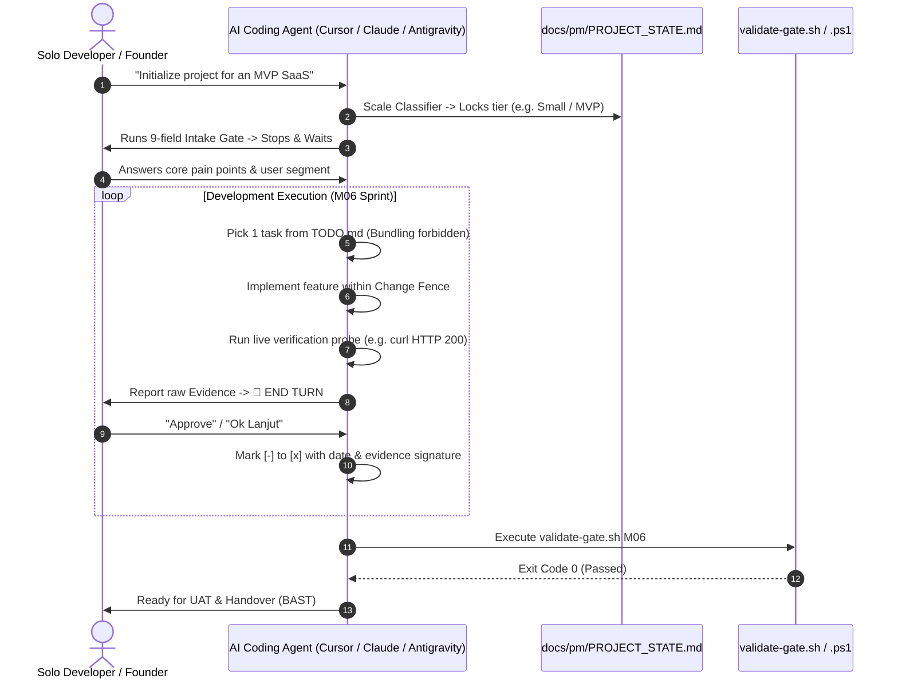

# Solo Project Lifecycle 🤖⚡

> **The Autonomous SDLC Operating System & Quality Gatekeeper for AI Coding Agents.**  
> *Turn Cursor, Claude Code, Antigravity, and Windsurf into a disciplined Senior Engineering Team.*

[](https://github.com/nothingser0/solo-project-lifecycle/releases/latest)
[](SKILL.md)
[](scripts/verify/verify-all.ps1)
[](LICENSE)

---

```
                       ┌────────────────────────────────────────┐
                       │       AUTONOMOUS AGENT HARNESS         │
                       └───────────────────┬────────────────────┘
                                           │
       ┌───────────────────────────────────┼───────────────────────────────────┐
       ▼                                   ▼                                   ▼
 🧠 Progressive Context             🛡️ Anti-Yes-Man                   🔍 Real Evidence Probe
 (≤2k tokens/phase, no leaks)       (Mandatory risk pushback)         (Zero fake mocks allowed)
       │                                   │                                   │
       └───────────────────────────────────┼───────────────────────────────────┘
                                           ▼
                       ┌────────────────────────────────────────┐
                       │  DETERMINISTIC GATEKEEPER (Exit: 0..5) │
                       │    ./scripts/gates/validate-gate.sh    │
                       └────────────────────────────────────────┘
```

---

## ⚡ The Agent Alignment Problem: Raw Agent vs. Harnessed Agent

Coding agents are brilliant at writing code, but chaotic at shipping production software. **Solo Project Lifecycle** provides the missing structural operating system:

| The Raw Agent (Without Framework) | The Harnessed Agent (With `solo-project-lifecycle`) |
|---|---|
| ❌ **Hallucinates Delivery**: Claims all screens are done, leaving empty `<400`-byte placeholder files. | ✅ **No-Fake Law**: Gate validator checks route size, interactivity, and rejects stub placeholders. |
| ❌ **Cites Fake Evidence**: Passes test suites by mocking out the very logic it was supposed to verify. | ✅ **Real Evidence Probe**: Verification requires executable route probes (HTTP 200/307) or live compiler output. |
| ❌ **Drive-By Refactoring**: Rewrites unrelated files, deletes comments, or renames variables unprompted. | ✅ **Change Fence**: Agent is locked to touching *only* the specific files declared in the active TODO task. |
| ❌ **Yes-Man Sycophancy**: Blindly agrees to over-engineered architectures or out-of-scope feature creep. | ✅ **Anti-Yes-Man Protocol**: Mandatory pushback protocol; agent must propose the simpler option before building. |
| ❌ **Context Amnesia**: Forgets architectural decisions after 10 turns and defaults to generic stacks. | ✅ **State-Locked Memory**: Single source of truth via `PROJECT_STATE.md` with gate-enforced handoffs. |
| ❌ **Code Slop**: Leaves `// fetch data`, `console.log`, unstyled `<select>`, and loose `: any` everywhere. | ✅ **Zero-Slop Rule**: Strict prohibition on debug logs, narrating comments, emoji icons, and raw selects. |

---

## 🧠 The Autonomous Cognition Loop



---

## 🎯 5W + 1H Quick Overview

* **WHAT**: An agent-agnostic SDLC framework consisting of **14 Lifecycle Modules (`M00`–`M13`)**, **Enterprise Series (`A00`–`A04`)**, **150+ operational templates**, and deterministic **CLI gate scripts**.
* **WHY**: To transform autonomous AI coding assistants from raw snippet generators into disciplined, senior-grade engineering partners that adhere to locked scopes, contracts, and quality standards.
* **WHO**: Solo developers, technical founders, indie hackers, and freelance software houses who need enterprise-level execution without hiring a 10-person agency.
* **WHEN**: Use for real products—commercial SaaS, client deliverables, MVPs, and production systems. *(Do not use for throwaway 1-file scripts or simple syntax lookups).*
* **WHERE**: Runs seamlessly inside **Google Antigravity**, **Cursor** (Agent mode), **Claude Code**, **Windsurf**, **Aider**, or raw terminal CLI across macOS, Linux, and Windows.
* **HOW**: Operates via progressive disclosure (≤2k tokens per phase), template-first scaffolding, and deterministic shell gate validators.

---

## 🛠️ Prompting Your Agent (Quick Start)

### 1. Mount the Skill
Clone the repository into your local or project skill directory:
```bash
git clone https://github.com/nothingser0/solo-project-lifecycle.git ~/.agents/skills/solo-project-lifecycle
```

### 2. Prompting Examples

```markdown
<!-- Starting a fast-track experiment -->
"Use solo-project-lifecycle in Spike/PoC mode to test feasibility of a local SQLite vector search."

<!-- Starting a commercial client project -->
"Act as my lead engineer using solo-project-lifecycle. Initialize a Client (Medium) project with SOW, DP milestones, and BAST handover."

<!-- Executing coding sprint with zero slop -->
"Load solo-project-lifecycle Module 06. Read TODO.md and execute the next task. Remember the Change Fence and one-task-per-turn rule."
```

---

## 📊 Scale Router & Delivery Tiers

The framework calibrates governance overhead based on project complexity:

```text
  [Spike / PoC] ──► 1-3 Days    ──► Feasibility tests / throwaway code (Zero gate scripts)
  [Small / MVP] ──► <4 Weeks    ──► 1-5 P0s, 1 decision maker, waived M01/M02, 2 human stops
  [Solo SaaS]   ──► 3-6 Weeks   ──► 6-15 P0s, Stripe/Midtrans billing, Solo SaaS Charter
  [Client]      ──► 6-15 P0s    ──► Contractual SOW, DP milestones, UAT workbook, signed BAST
  [Enterprise]  ──► 16+ P0s     ──► Capacity Risk Gate exit 5, or A00-A04 Enterprise Advisory
```

---

## 🗂️ 14 Lifecycle Modules (The Agent Skill Matrix)

| Phase | Module | Autonomous Subroutine Scope |
|:---|:---|:---|
| **Discovery** | `M00` Product Discovery | RAT riskiest assumption testing, competitive alternative matrix |
| | `M01` Idea Feasibility | Unit economics sanity check, margin target validation, Go/Kill decision |
| | `M02` Discovery & Scoping | User journeys, MoSCoW scope freeze, acceptance criteria definition |
| **Commercial** | `M03` Legal & Charter | Client SOW/SPK contracts, down-payment gates, Solo SaaS Charter |
| **Design** | `M04` UI/UX Prototyping | Reference intake, vector SVG logos, Reusable Component Showcase, Visual DNA |
| **Specs** | `M05` Architecture & Specs | PRD synthesis, Technical FSD, schema locking, tech stack lock |
| **Build** | `M06` Dev Execution | 9-file agent harness, atomic TODO decomposition, zero broken build |
| | `M07` QA & SIT | System integration test workbook, security audits, OWASP baselines |
| | `M08` Data Migration | Zero-downtime cutover plan, seeder idempotency, data reconciliation |
| **Delivery** | `M09` UAT & Client Sign-Off | Client acceptance workbook, structured defect triage, human sign-off |
| | `M10` Production Deployment | Zero-downtime cutover protocol, production smoke tests, rollback procedures |
| | `M11` Handover & BAST | Official Berita Acara Serah Terima (BAST), credential rotation, final invoice |
| **Operations**| `M12` Warranty & Retainer | SLA/SLO commitments, incident response runbooks, maintenance retainers |
| | `M13` Operations & Growth | Product metrics, A/B testing analysis (`analyze_ab_test.py`), backlog iteration |

---

## 💻 CLI & Gate Validator Tooling

```bash
# 1. Scaffolding a structured project directory
./scripts/scaffold/init-project.sh ~/projects/my-saas medium

# 2. Decomposing FSD & Sitemap specs into 1-to-1 executable TODO tasks
./scripts/scaffold/generate-todo.sh TODO.md

# 3. Deterministic Gate Validation (Windows PowerShell or Bash)
powershell -File ./scripts/gates/validate-gate.ps1 M05
# Output:
#   🔍 Validating Gate: M05 (Architecture & Specs)
#   ✅ Tech Stack Decision LOCKED
#   ✅ Entity model relationships verified
#   ============================================================
#   ✅ Gate validation PASSED (Exit code: 0)
```

---

## 📜 Compliance & Regional Support

Native patterns tailored for regional business standards and international compliance:
* **Indonesian Commercial Context**: SOW/SPK agreements, down-payment milestones, BAST acceptance instruments, e-Meterai validation, and PPN compliance.
* **Payment Gateways**: Midtrans, Xendit, and QRIS webhook idempotency and signature verification.
* **Data Privacy Regulations**: Indonesia UU PDP (Pelindungan Data Pribadi), GDPR, and SOC2/ISO27001 readiness checklists.

---

## 📄 License

Distributed under the [MIT License](LICENSE). Built for the next generation of solo builders and autonomous coding agents.
