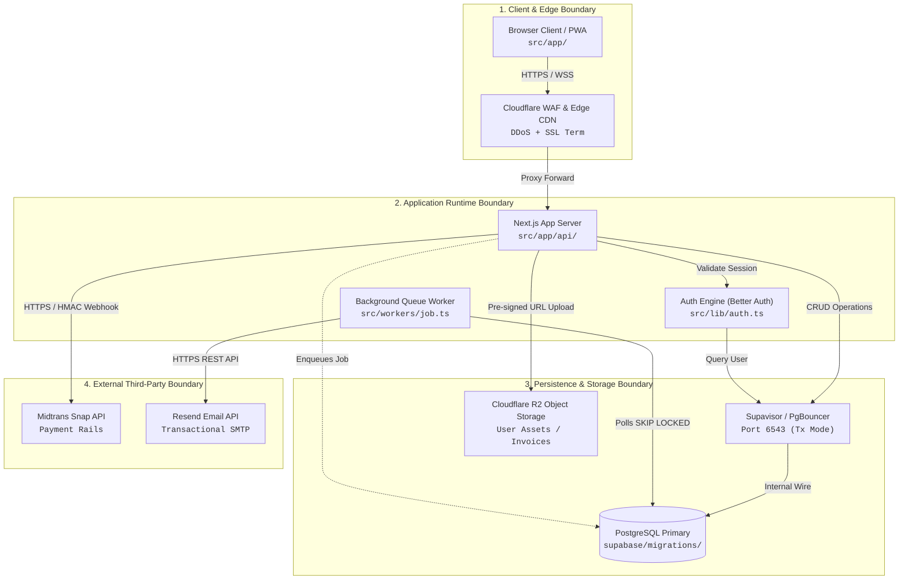

# Repository-Backed Architecture Diagram Pattern

> **Module**: M05 (Architecture & Technical Specifications) & M06 (Development Execution)  
> **Source**: Adapted from a published architecture-visualization tool's production standards.  
> **Scope**: Authoritative engineering rules for creating verifiable, source-backed architecture diagrams and system topologies. Eliminates hand-waving architecture diagrams, hallucinated microservices, and ungrounded box-and-arrow diagrams.

---

## 1. The Core Problem & Anti-Hallucination Mandate

In typical software specifications, architecture diagrams suffer from two fatal flaws:
1. **Unchecked Fantasy Architectures**: AI agents and inexperienced developers draw complex clusters of microservices, event buses, and caches that do not exist anywhere in code.
2. **Disconnected Box-and-Arrow Diagrams**: Components lack precise protocol labels, port definitions, boundary contracts, or file ownership.

### The Source-Backed Golden Rule
> **Every node, boundary, and data-flow edge in a system architecture diagram MUST be anchored in verified repository evidence (`path`, `line`, `commit`). If a component does not exist in code or IaC configuration, it MUST NOT be depicted as a live production component.**

---

## 2. The 4-Boundary Topological Hierarchy

When mapping system architecture, group components strictly into **4 standard topological boundaries** with unidirectional Left-to-Right ($L \to R$) or Top-to-Bottom ($T \to B$) data flow:

```text
┌────────────────────────────────────────────────────────────────────────┐
│ 1. CLIENT & EDGE BOUNDARY (Public Ingress)                            │
│    • Client Apps (Web Next.js / Mobile React Native)                   │
│    • Edge CDN & DDoS WAF (Cloudflare Edge / Vercel Edge Network)       │
└───────────────────────────────────┬────────────────────────────────────┘
                                    │ HTTPS / WSS (Port 443)
┌───────────────────────────────────▼────────────────────────────────────┐
│ 2. APPLICATION RUNTIME BOUNDARY (Compute & Logic)                      │
│    • App Server / Next.js Server Actions / API Gateway                 │
│    • Background Worker Processors (pg-boss / BullMQ / Cron)            │
│    • Auth Middleware & Session Engine (Better Auth / Supabase Auth)    │
└───────────────────┬───────────────────────────────┬────────────────────┘
                    │ PostgreSQL Wire (Port 5432/6543)│ HTTPS / S3 API
┌───────────────────▼───────────────────────┐ ┌─────▼────────────────────┐
│ 3. PERSISTENCE & STORAGE BOUNDARY         │ │ 4. EXTERNAL 3RD-PARTY    │
│    • Primary Relational DB (PostgreSQL)   │ │    SERVICES BOUNDARY     │
│    • Connection Pooler (PgBouncer/Supavisor)│ Payment Gateway (Midtrans│
│    • Object Storage (Cloudflare R2 / S3)  │ │ • Email API (Resend)     │
│    • In-Memory Cache (Redis / Keyv)       │ │ • AI APIs (OpenAI/Anthr.)│
└───────────────────────────────────────────┘ └──────────────────────────┘
```

### Boundary Classification Rules:
1. **Client & Edge Boundary**: End-user entry points, DNS, SSL termination, rate-limiting, and static asset distribution.
2. **Application Runtime Boundary**: Code execution environments where business logic runs, sessions are validated, and mutations are initiated.
3. **Persistence & Storage Boundary**: Authoritative state, ACID relational tables, object buckets, and ephemeral caches.
4. **External Third-Party Services**: External SaaS APIs operating outside the team's direct infrastructure perimeter.

---

## 3. Component Specification & Source Evidence Schema

For each component depicted in the architecture, the specification in `docs/specs/FSD.md` or root `ARCHITECTURE.md` must declare exact repository evidence:

```markdown
### Component: Auth Middleware & Session Engine
- **Type**: Application Runtime
- **Repository Source**: `src/middleware.ts` (lines 14–48)
- **Runtime Environment**: Edge Runtime / Node.js 20
- **Ingress Protocol**: HTTPS (Port 443)
- **Egress Targets**:
  - `Database Pooler` via PostgreSQL Wire protocol on port `6543`
  - `Redis Session Cache` via TCP on port `6379`
- **Failure Mode & Fallback**: If Redis unreachable, fallback to direct DB lookup with exponential backoff.
```

---

## 4. Connection & Flow Labeling Discipline

Every connection line between components must carry three explicit attributes:
1. **Protocol & Port**: Never draw a bare arrow. Specify `HTTPS (443)`, `WSS (443)`, `TCP (6379)`, `gRPC (50051)`, or `PostgreSQL Wire (5432/6543)`.
2. **Data Payload & Interaction Type**:
   - `Synchronous Request/Response` (e.g. `POST /api/v1/invoices` $\to$ Returns `201 Created`).
   - `Asynchronous Fire-and-Forget` (e.g. `Publish event 'invoice.generated'`).
   - `Polling / Subscription` (e.g. `WSS subscribe 'channel:room-101'`).
3. **Authentication & Trust Crossing**: Explicitly mark when a connection crosses from untrusted public space into private VPC / authenticated networks.

---

## 5. Standard Interactive Mermaid Template

Solo developers and AI agents must embed this verifiable architecture diagram into `docs/specs/FSD.md` and root `ARCHITECTURE.md`:



---

## 6. Verification Checklist for Architecture Diagrams

Before locking M05 FSD or deploying root `ARCHITECTURE.md`, verify:
- [ ] **Zero Fabricated Components**: Every box maps to an actual file in the codebase or infrastructure config.
- [ ] **No Naked Arrows**: Every connection specifies protocol and purpose (no vague lines).
- [ ] **Database Connection Pooler Explicit**: Direct connections to port `5432` from serverless functions are flagged as antipatterns; pooler (`6543`) is explicitly shown.
- [ ] **4-Boundary Layout Maintained**: Components are properly categorized into Edge, Runtime, Storage, and Third-Party.
