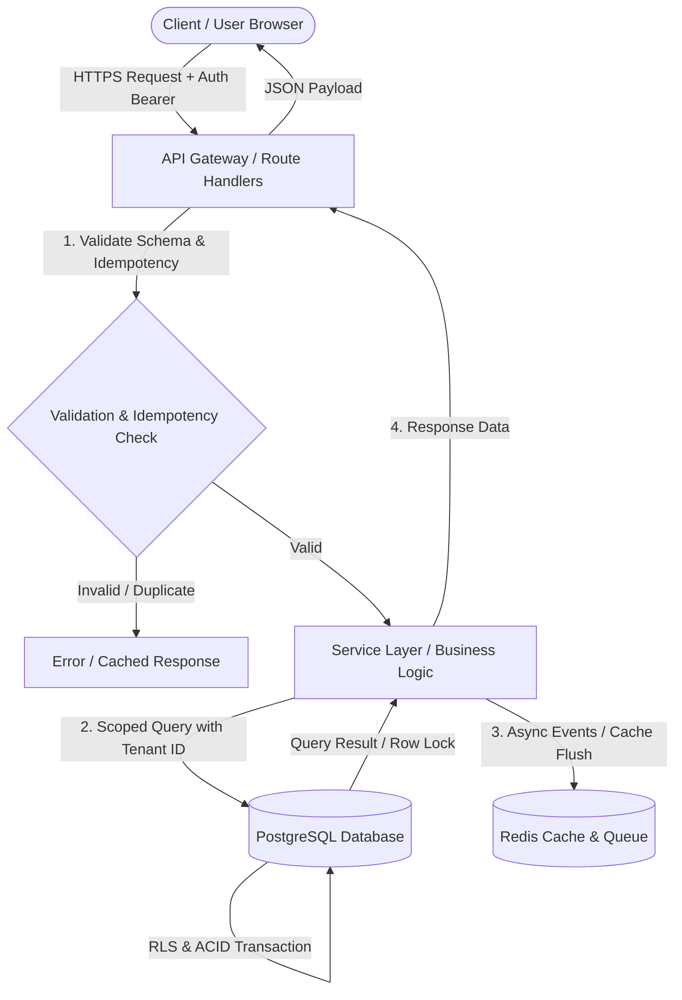
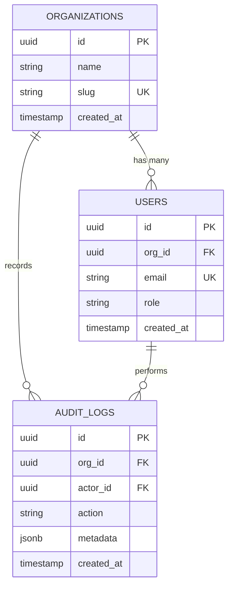
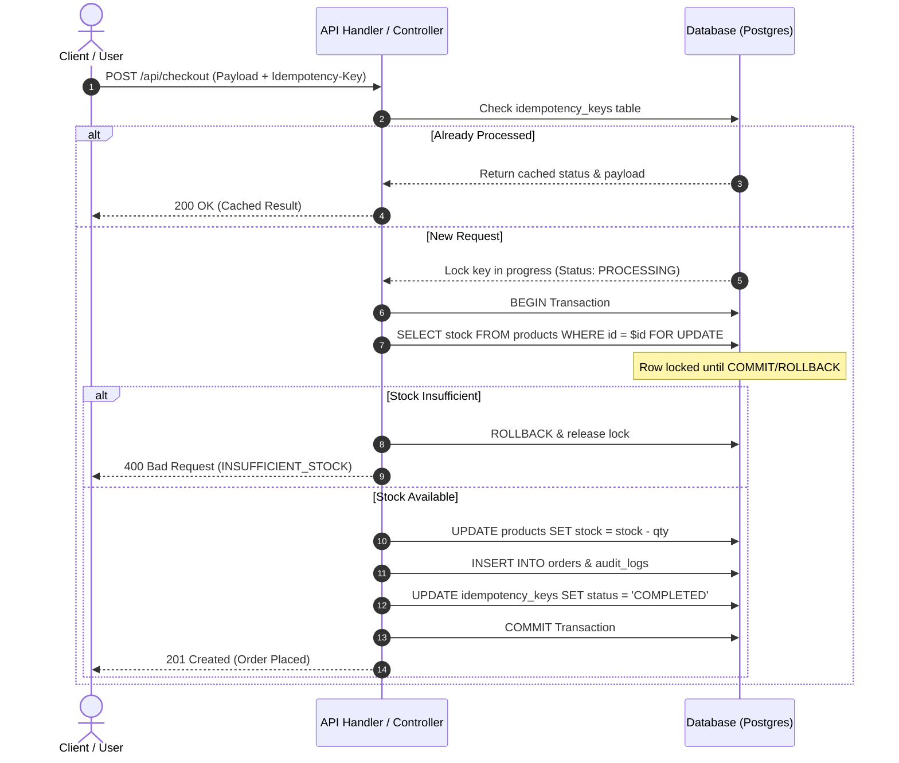

# Functional Specification Document (FSD) — Technical Architecture & Database DDL

> **Purpose**: Definitive engineering blueprint defining "HOW" the system is constructed: standard SQL DDL, access control & RLS architecture, atomic transaction functions with row-locking, append-only journals, idempotency caches, and immutable audit logs.
> **Standard**: Zero silent RLS data leaks, zero client-side race conditions, and hardened `SECURITY DEFINER` execution across all project scales (Small, Medium, Large, Enterprise) and software domains (CRM, CMS, HRIS, E-Commerce, Fintech, SaaS, Developer Tools).
> **Output**: `docs/specs/FSD.md`

---

## 1. Document Metadata
- **System / Application Name**: [System / Application Name]
- **Client / Organization**: [Client Company / Organization]
- **Lead Software Architect**: [Your Name]
- **Project Domain**: [CRM / CMS / HRIS / E-Commerce / Fintech / B2B SaaS / Developer Tool]
- **Defined Project Scale**: [Small (MVP) / Medium (SaaS) / Large / Enterprise]
- **PRD Reference**: `docs/specs/PRD.md` (v1.0 Approved)
- **Design Reference**: `docs/specs/DESIGN_SPEC.md` (v1.0 Frozen)
- **Specification Version**: 1.0.0
- **Document Status**: [APPROVED_FOR_BUILD]
- **Approval Date**: [YYYY-MM-DD]

### 1.1 Scale-Adaptive FSD Architecture Framework
*Adapt technical depth and architectural patterns based on project scale:*

| Scale Tier | Typical Tables | State & Persistence Architecture | Concurrency & Isolation | Security Architecture |
| :--- | :---: | :--- | :--- | :--- |
| **Small (MVP / Internal Tool)** | 3–6 tables | Standard relational tables with `created_at`/`updated_at`; simple audit logging | Database unique constraints & client submit debouncing | Application-layer auth; basic RLS or single-tenant database |
| **Medium (B2B SaaS / Agency)** | 10–20 tables | State machine / event journals; cached aggregate projections; versioned migrations | Atomic transactions / stored procedures (`FOR UPDATE`) on critical paths | 100% multi-tenant RLS (`org_id`); hardened `SECURITY DEFINER` helper functions |
| **Large (Scale-Up / Multi-System)**| 20–35 tables | Full append-only movement ledgers; decoupled background workers; Redis caching | Row-level locking; idempotency key response caches; partition strategies | Role-scoped RLS; database view isolation; rate limiting; KMS encryption |
| **Enterprise (Corporate / Regulated)**| 40+ tables | Immutable audit vaults; event sourcing; high-concurrency read replicas | Sharding / time-series partitioning; multi-master or distributed consensus | SOC2 / ISO 27001 / UU PDP compliance; HSM keys; multi-tier CAB sign-off |

---

## 2. Component Architecture & Tech Stack Decisions

```text
[ Browser / Mobile Client / External Worker ]
                    │
                    ▼ (HTTPS / TLS 1.3 - JSON API / WebSockets)
        [ Reverse Proxy / Edge CDN (Cloudflare / Caddy) ]
                    │
                    ▼
        [ Application Backend (Next.js / Laravel / Django / Go / Rails) ]
                    │
                    ├──► [ Database: PostgreSQL (Managed / Supabase / Local) ]
                    │     ├── Access Isolation (RLS / Tenant Scoping)
                    │     ├── Atomic Transactions & Concurrency Guards
                    │     └── Audit Logs & State Event Journals
                    │
                    ├──► [ In-Memory Cache / Worker Queue: Redis (Optional) ]
                    │     └── Rate Limiting, Session Stores, Background Jobs
                    │
                    └──► [ Object Storage: S3 / Cloudflare R2 (Optional) ]
                          └── Encrypted Assets & Presigned URLs
```

### 2.1 Data Flow Diagram (DFD / Data Architecture)



### 2.2 Entity Relationship Diagram (ERD)





### Stack Decision (LOCKED — human decision, gate-enforced)

Stack Decision LOCKED: [chosen stack]
Stack-Locked-by: [Human Name] on [YYYY-MM-DD]

> ⚠️ **M05 GATE ENFORCEMENT**: `validate-gate.sh M05` fails if `Stack Decision LOCKED:` appears without the 8
> recorded questionnaire answers below, or if `Stack-Locked-by:` still contains brackets or template placeholders.
> The agent asks the 8 questions; the human answers and locks the stack. Replace `[Human Name]` with the actual human name.

- Q1 Team Expertise: [answer]
- Q2 Database Experience: [answer]
- Q3 Deployment Topology: [answer]
- Q4 Expected Scale (Year 1): [answer]
- Q5 Data Model Characteristics: [answer]
- Q6 DevOps Complexity Tolerance: [answer]
- Q7 Critical Feature Priority: [answer]
- Q8 Compliance Requirements: [answer]

### Framework Versions & Ecosystem Libraries (Pinned)
*(Populate directly from `./scripts/verify/check-package-versions.sh <stack>` — see the live-version STEP 0 in `docs/modules/05_ARCHITECTURE_SPECS.md`)*
- **Framework**: [e.g., Next.js ^15.0.3 (App Router) / Laravel v13.x / Django ^6.1.1 / Go go1.27.1 / Rails ~8.1.4]
- **Language / Runtime**: [e.g., Node.js 22 LTS / PHP ^8.3 / Python >=3.12 / Go 1.27 / Ruby >=3.2.0]
- **Database Engine**: PostgreSQL 16+ (or MySQL / SQLite appropriate to scale)
- **ORM / Driver**: [e.g., Drizzle ORM / Prisma / Eloquent / GORM / psycopg]
- **Authentication & Session**: [e.g., Better Auth / Supabase Auth / Laravel Breeze / Laravel Sanctum / NextAuth / Lucia]
- **Form & Schema Validation**: [e.g., Zod ^3.23.8 / Valibot / Laravel Form Requests / Pydantic]
- **State Management & Query Cache**: [e.g., TanStack Query ^5.x / Zustand / Pinia / React Context]
- **UI & Motion Component Suite**: [e.g., shadcn/ui + Radix UI + Lucide React + Framer Motion (per `patterns/ui/UI_COMPONENT_TAXONOMY.md` and `patterns/ui/MOTION_DESIGN_TAXONOMY.md`)]


### Module 04 Handoff Strategy

> **Why this section exists**: `validate-gate.sh M06` refuses to start coding without
> it. It records how the **frozen** Module 04 prototype becomes real code, so no one
> re-invents screens during development. The prototype is the UI source of truth.

**Compatibility Level**: [Level 1 | Level 2 | Level 3 | Level 4]

| Level | Meaning | Conversion effort |
| :---: | :--- | :--- |
| **1** | AI-generated prototype code (Workflow A) — v0/Bolt/Lovable export, cleaned and wired | Low: refactor to conventions |
| **2** | Figma/designer export (Workflow B) — components/screens extracted from design tool | Medium: design → components |

**Conversion Plan**:
1. [Source artifact → target path, e.g. "Extract 12 components from `docs/design/screens/` → `src/components/`"]
2. [Route mapping, e.g. "Create one route per SITEMAP screen (SCR-01…SCR-NN)"]
3. [Rejected prototype code / stubs to delete, e.g. "Drop prototype mock data; bind to FSD endpoints"]

**Estimated Conversion Time**: [N days]
**Screen Coverage**: [SITEMAP route count] routes == [DESIGN_SPEC SCR count] frozen screens

---

## 3. Relational Database Schema & DDL Integrity (SQL DDL)

### 3.1 DDL Integrity Rules
1. **Monetary Precision**: All currency amounts MUST use `BIGINT` (stored in smallest currency unit / full Rupiah) or `NUMERIC(15, 2)` to eliminate floating-point rounding errors.
2. **Quantity Precision**: Quantities supporting fractional measurements (weights, volumes, hours) MUST use `NUMERIC(12, 3)`. Whole items use `INTEGER`.
3. **100% Foreign Key Indexing**: Every column with a `REFERENCES` constraint **MUST** have an explicit `CREATE INDEX` to prevent sequential table scans under load.
4. **Strict CHECK Constraints**: Enforce domain invariants and arithmetic correctness directly in the database engine.

```sql
-- Extensions
CREATE EXTENSION IF NOT EXISTS "uuid-ossp";
CREATE EXTENSION IF NOT EXISTS "pgcrypto";

-- ============================================================================
-- CORE PLATFORM SCHEMA (Universal: Multi-Tenant & User Access)
-- ============================================================================

-- 1. Organizations (Tenants)
CREATE TABLE organizations (
    id UUID PRIMARY KEY DEFAULT uuid_generate_v4(),
    name VARCHAR(255) NOT NULL,
    slug VARCHAR(100) UNIQUE NOT NULL,
    is_active BOOLEAN NOT NULL DEFAULT TRUE,
    created_at TIMESTAMPTZ NOT NULL DEFAULT now(),
    updated_at TIMESTAMPTZ NOT NULL DEFAULT now()
);

-- 2. Users & Tenant Roles
CREATE TABLE users (
    id UUID PRIMARY KEY REFERENCES auth.users(id) ON DELETE CASCADE,
    org_id UUID NOT NULL REFERENCES organizations(id) ON DELETE RESTRICT,
    email VARCHAR(255) NOT NULL,
    full_name VARCHAR(150) NOT NULL,
    role VARCHAR(30) NOT NULL CHECK (role IN ('Owner', 'Manager', 'Staff', 'Auditor')),
    is_active BOOLEAN NOT NULL DEFAULT TRUE,
    created_at TIMESTAMPTZ NOT NULL DEFAULT now(),
    updated_at TIMESTAMPTZ NOT NULL DEFAULT now(),
    CONSTRAINT uq_users_org_email UNIQUE (org_id, email)
);
CREATE INDEX idx_users_org_id ON users(org_id);

-- ============================================================================
-- DOMAIN SCHEMAS (Select the pattern matching project domain; adapt or mark N/A)
-- ============================================================================

-- ----------------------------------------------------------------------------
-- PATTERN A: Commerce / Inventory / Transactions (Retail / POS / WMS Scope)
-- ----------------------------------------------------------------------------
CREATE TABLE products (
    id UUID PRIMARY KEY DEFAULT uuid_generate_v4(),
    org_id UUID NOT NULL REFERENCES organizations(id) ON DELETE RESTRICT,
    sku VARCHAR(100) NOT NULL,
    barcode VARCHAR(100),
    name VARCHAR(255) NOT NULL,
    unit VARCHAR(30) NOT NULL DEFAULT 'pcs',
    buy_price BIGINT NOT NULL CHECK (buy_price >= 0),
    sell_price BIGINT NOT NULL CHECK (sell_price >= buy_price),
    min_stock NUMERIC(12, 3) NOT NULL DEFAULT 0 CHECK (min_stock >= 0),
    is_active BOOLEAN NOT NULL DEFAULT TRUE,
    created_at TIMESTAMPTZ NOT NULL DEFAULT now(),
    updated_at TIMESTAMPTZ NOT NULL DEFAULT now(),
    CONSTRAINT uq_product_sku_per_org UNIQUE (org_id, sku)
);
CREATE INDEX idx_products_org_id ON products(org_id);
CREATE INDEX idx_products_barcode ON products(org_id, barcode) WHERE barcode IS NOT NULL;

CREATE TABLE inventory (
    id UUID PRIMARY KEY DEFAULT uuid_generate_v4(),
    org_id UUID NOT NULL REFERENCES organizations(id) ON DELETE RESTRICT,
    product_id UUID NOT NULL REFERENCES products(id) ON DELETE RESTRICT,
    quantity NUMERIC(12, 3) NOT NULL DEFAULT 0,
    updated_at TIMESTAMPTZ NOT NULL DEFAULT now(),
    CONSTRAINT uq_inventory_product_org UNIQUE (org_id, product_id)
);
CREATE INDEX idx_inventory_org_id ON inventory(org_id);
CREATE INDEX idx_inventory_product_id ON inventory(product_id);

CREATE TABLE inventory_movements (
    id UUID PRIMARY KEY DEFAULT uuid_generate_v4(),
    org_id UUID NOT NULL REFERENCES organizations(id) ON DELETE RESTRICT,
    product_id UUID NOT NULL REFERENCES products(id) ON DELETE RESTRICT,
    movement_type VARCHAR(30) NOT NULL CHECK (movement_type IN ('INBOUND', 'OUTBOUND', 'ADJUSTMENT', 'VOID_RETURN')),
    quantity NUMERIC(12, 3) NOT NULL,
    unit_cost BIGINT NOT NULL CHECK (unit_cost >= 0),
    reference_id UUID NOT NULL,
    created_by UUID NOT NULL REFERENCES users(id),
    created_at TIMESTAMPTZ NOT NULL DEFAULT now()
);
CREATE INDEX idx_movements_org_id ON inventory_movements(org_id);
CREATE INDEX idx_movements_prod_time ON inventory_movements(product_id, created_at);

-- ----------------------------------------------------------------------------
-- PATTERN B: CRM / Pipeline / Activity Journals (CRM / Lead Management Scope)
-- ----------------------------------------------------------------------------
CREATE TABLE crm_deals (
    id UUID PRIMARY KEY DEFAULT uuid_generate_v4(),
    org_id UUID NOT NULL REFERENCES organizations(id) ON DELETE RESTRICT,
    title VARCHAR(255) NOT NULL,
    deal_value BIGINT NOT NULL DEFAULT 0 CHECK (deal_value >= 0),
    stage VARCHAR(50) NOT NULL CHECK (stage IN ('LEAD', 'CONTACTED', 'PROPOSAL', 'NEGOTIATION', 'WON', 'LOST')),
    assigned_to UUID REFERENCES users(id) ON DELETE SET NULL,
    created_at TIMESTAMPTZ NOT NULL DEFAULT now(),
    updated_at TIMESTAMPTZ NOT NULL DEFAULT now()
);
CREATE INDEX idx_deals_org_id ON crm_deals(org_id);
CREATE INDEX idx_deals_assigned ON crm_deals(assigned_to);

-- ----------------------------------------------------------------------------
-- PATTERN C: CMS / Content Lifecycle & Revisions (CMS / Publishing Scope)
-- ----------------------------------------------------------------------------
CREATE TABLE cms_articles (
    id UUID PRIMARY KEY DEFAULT uuid_generate_v4(),
    org_id UUID NOT NULL REFERENCES organizations(id) ON DELETE RESTRICT,
    slug VARCHAR(255) NOT NULL,
    title VARCHAR(255) NOT NULL,
    content TEXT NOT NULL,
    status VARCHAR(30) NOT NULL DEFAULT 'DRAFT' CHECK (status IN ('DRAFT', 'IN_REVIEW', 'SCHEDULED', 'PUBLISHED', 'ARCHIVED')),
    published_at TIMESTAMPTZ,
    author_id UUID NOT NULL REFERENCES users(id) ON DELETE RESTRICT,
    created_at TIMESTAMPTZ NOT NULL DEFAULT now(),
    updated_at TIMESTAMPTZ NOT NULL DEFAULT now(),
    CONSTRAINT uq_article_slug_org UNIQUE (org_id, slug)
);
CREATE INDEX idx_articles_org_id ON cms_articles(org_id);
CREATE INDEX idx_articles_status ON cms_articles(status, published_at);

-- ============================================================================
-- COMMON PLATFORM INFRASTRUCTURE (Idempotency & Immutable Audit Logs)
-- ============================================================================

-- Idempotency Request Cache (Prevents duplicate processing on network retry)
CREATE TABLE idempotency_keys (
    id UUID PRIMARY KEY DEFAULT uuid_generate_v4(),
    org_id UUID NOT NULL REFERENCES organizations(id) ON DELETE CASCADE,
    idempotency_key VARCHAR(100) NOT NULL,
    response_code INT NOT NULL,
    response_body JSONB NOT NULL,
    created_at TIMESTAMPTZ NOT NULL DEFAULT now(),
    expires_at TIMESTAMPTZ NOT NULL DEFAULT (now() + INTERVAL '24 hours'),
    CONSTRAINT uq_idempotency_org_key UNIQUE (org_id, idempotency_key)
);
CREATE INDEX idx_idempotency_org_key ON idempotency_keys(org_id, idempotency_key);
CREATE INDEX idx_idempotency_expires ON idempotency_keys(expires_at);

-- Automated TTL Cleanup: An index on expires_at does not auto-purge rows.
-- Purge expired keys via pg_cron or periodic background worker: DELETE FROM idempotency_keys WHERE expires_at < now();

-- Immutable Audit Trail
CREATE TABLE audit_logs (
    id UUID PRIMARY KEY DEFAULT uuid_generate_v4(),
    org_id UUID NOT NULL REFERENCES organizations(id) ON DELETE CASCADE,
    user_id UUID REFERENCES users(id) ON DELETE SET NULL,
    action VARCHAR(50) NOT NULL,
    entity_type VARCHAR(50) NOT NULL,
    entity_id UUID NOT NULL,
    changes JSONB,
    created_at TIMESTAMPTZ NOT NULL DEFAULT now()
);
CREATE INDEX idx_audit_logs_org_id ON audit_logs(org_id);
CREATE INDEX idx_audit_logs_entity ON audit_logs(entity_type, entity_id);
CREATE INDEX idx_audit_logs_created_at ON audit_logs(created_at);
```

---

## 4. Multi-Tenant Row-Level Security (RLS) Architecture

*(Applicable when building multi-tenant SaaS or exposing database directly to client SDKs. For single-tenant internal apps or backend-only APIs, document application-layer authorization and mark database RLS N/A)*

### 4.1 Security Definer Helper Function Hardening
```sql
-- Secure helper function locking search_path to prevent privilege escalation exploits:
CREATE OR REPLACE FUNCTION get_current_user_org_id()
RETURNS UUID AS $$
  SELECT org_id FROM public.users WHERE id = auth.uid() AND is_active = TRUE;
$$ LANGUAGE sql SECURITY DEFINER SET search_path = public, pg_temp STABLE;

CREATE OR REPLACE FUNCTION get_current_user_role()
RETURNS VARCHAR AS $$
  SELECT role FROM public.users WHERE id = auth.uid() AND is_active = TRUE;
$$ LANGUAGE sql SECURITY DEFINER SET search_path = public, pg_temp STABLE;
```

### 4.2 Explicit Granular RLS Policies (Zero Lax `FOR ALL`)

```sql
-- Enable RLS on multi-tenant tables:
ALTER TABLE organizations ENABLE ROW LEVEL SECURITY;
ALTER TABLE users ENABLE ROW LEVEL SECURITY;
ALTER TABLE products ENABLE ROW LEVEL SECURITY;
ALTER TABLE inventory ENABLE ROW LEVEL SECURITY;
ALTER TABLE inventory_movements ENABLE ROW LEVEL SECURITY;
ALTER TABLE crm_deals ENABLE ROW LEVEL SECURITY;
ALTER TABLE cms_articles ENABLE ROW LEVEL SECURITY;
ALTER TABLE idempotency_keys ENABLE ROW LEVEL SECURITY;
ALTER TABLE audit_logs ENABLE ROW LEVEL SECURITY;

-- 1. Tenant Data Isolation Policies
CREATE POLICY users_isolation_policy ON users
    FOR SELECT USING (org_id = get_current_user_org_id());

CREATE POLICY products_isolation_policy ON products
    FOR SELECT USING (org_id = get_current_user_org_id());

CREATE POLICY deals_isolation_policy ON crm_deals
    FOR ALL USING (org_id = get_current_user_org_id());

CREATE POLICY articles_isolation_policy ON cms_articles
    FOR ALL USING (org_id = get_current_user_org_id());

-- 2. Immutable Event & Audit Log Policies (Append-Only Enforcement)
CREATE POLICY movements_select_policy ON inventory_movements
    FOR SELECT USING (org_id = get_current_user_org_id());

CREATE POLICY movements_insert_policy ON inventory_movements
    FOR INSERT WITH CHECK (org_id = get_current_user_org_id());

CREATE POLICY audit_logs_select_policy ON audit_logs
    FOR SELECT USING (org_id = get_current_user_org_id());

CREATE POLICY audit_logs_insert_policy ON audit_logs
    FOR INSERT WITH CHECK (org_id = get_current_user_org_id());

-- STRICT RULE: ZERO UPDATE OR DELETE POLICIES ON AUDIT LOGS OR MOVEMENT JOURNALS!
-- PostgreSQL denies UPDATE/DELETE by default when no policy exists.
```

### 4.3 Database View Isolation (Sensitive Field Masking)
*(Enforce database-level masking where lower-privileged roles must not see sensitive costs, margins, or salaries)*
```sql
CREATE OR REPLACE VIEW products_public_view AS
SELECT
    id, org_id, sku, barcode, name, unit, sell_price, is_active, created_at
FROM public.products
WHERE is_active = TRUE;
-- Notice: Sensitive buy_price is completely excluded from projection!

GRANT SELECT ON products_public_view TO authenticated;
```

---

## 5. Atomic Concurrency Guards & Stored Procedures (Conditional)

*(Applicable to high-concurrency state transitions, seat reservations, checkout mutations, or balance settlements; mark N/A for standard low-concurrency CRUD)*

### 5.1 Failure Mode: Client-Side Multi-Step Mutation Race Condition
Executing balance deductions or state transitions via sequential client-side API calls causes race conditions under concurrent submissions. If two users mutate the last available unit simultaneously, both succeed, resulting in data inconsistency or overselling.

### 5.2 Atomic Stored Procedure Pattern (Row-Locking via `SELECT FOR UPDATE`)
> 💡 *Illustrative Architectural Pattern: The following procedure demonstrates server-side tenant authorization, atomic idempotency locking, and deterministic row-locking. Adapt table names, lock hierarchy, and error codes to your project's specific domain entities.*

```sql
CREATE OR REPLACE FUNCTION rpc_execute_atomic_checkout(
    p_org_id UUID,
    p_idempotency_key VARCHAR(100),
    p_product_id UUID,
    p_quantity NUMERIC(12, 3)
)
RETURNS JSONB
LANGUAGE plpgsql
SECURITY DEFINER
SET search_path = public, pg_temp
AS $$
DECLARE
    v_current_stock NUMERIC(12, 3);
    v_server_price BIGINT;
    v_server_cost BIGINT;
    v_existing_response JSONB;
    v_actor_id UUID := auth.uid();
    v_user_org_id UUID;
BEGIN
    -- 0. Authentication & Organization Membership Validation
    IF v_actor_id IS NULL THEN
        RAISE EXCEPTION 'Authentication required to execute atomic mutation';
    END IF;

    IF p_quantity <= 0 THEN
        RAISE EXCEPTION 'Invalid mutation quantity: % must be greater than zero', p_quantity;
    END IF;

    SELECT org_id INTO v_user_org_id
    FROM public.users
    WHERE id = v_actor_id AND is_active = TRUE;

    IF v_user_org_id IS NULL OR v_user_org_id != p_org_id THEN
        RAISE EXCEPTION 'Unauthorized: User does not belong to specified organization';
    END IF;

    -- 1. Idempotency Check: Return cached response if already committed
    SELECT response_body INTO v_existing_response
    FROM idempotency_keys
    WHERE org_id = p_org_id AND idempotency_key = p_idempotency_key;

    IF v_existing_response IS NOT NULL THEN
        RETURN v_existing_response;
    END IF;

    -- 2. ROW-LOCKING: Lock inventory record exclusively to prevent concurrent race condition:
    -- Note: In multi-item transactions, always query and lock resources in deterministic order (ORDER BY product_id ASC)
    SELECT quantity INTO v_current_stock
    FROM inventory
    WHERE org_id = p_org_id AND product_id = p_product_id
    FOR UPDATE;

    IF NOT FOUND THEN
    RAISE EXCEPTION 'Resource not found or unstocked in this organization';
    END IF;

    IF v_current_stock < p_quantity THEN
        RAISE EXCEPTION 'Insufficient stock. Available: %, Requested: %', v_current_stock, p_quantity;
    END IF;

    -- 3. Fetch server truth pricing (anti-tampering)
    SELECT sell_price, buy_price INTO v_server_price, v_server_cost
    FROM products
    WHERE id = p_product_id AND org_id = p_org_id;

    IF NOT FOUND THEN
    RAISE EXCEPTION 'Resource inactive or unavailable';
    END IF;

    -- 4. Deduct inventory aggregate
    UPDATE inventory
    SET quantity = quantity - p_quantity, updated_at = now()
    WHERE org_id = p_org_id AND product_id = p_product_id;

    -- 5. Record immutable movement ledger
    INSERT INTO inventory_movements (
        org_id, product_id, movement_type, quantity, unit_cost, reference_id, created_by
    ) VALUES (
        p_org_id, p_product_id, 'OUTBOUND', -p_quantity, v_server_cost, gen_random_uuid(), v_actor_id
    );

    -- 6. Atomically persist idempotency response within the same transaction.
    -- Concurrency Behavior: If an identical concurrent request inserts the same key before this commits,
    -- PostgreSQL raises a unique violation (23505) and rolls back the duplicate. The application layer handles 23505 by re-reading the committed response.
    v_existing_response := jsonb_build_object('status', 'SUCCESS', 'product_id', p_product_id, 'deducted', p_quantity);
    INSERT INTO idempotency_keys (org_id, idempotency_key, response_code, response_body)
    VALUES (p_org_id, p_idempotency_key, 200, v_existing_response);

    RETURN v_existing_response;
END;
$$;

-- Restrict execution permissions (never leave SECURITY DEFINER callable by anonymous public):
REVOKE EXECUTE ON FUNCTION rpc_execute_atomic_checkout(UUID, VARCHAR, UUID, NUMERIC) FROM PUBLIC;
GRANT EXECUTE ON FUNCTION rpc_execute_atomic_checkout(UUID, VARCHAR, UUID, NUMERIC) TO authenticated;
```

---

## 6. API Contract Specifications (REST / JSON API)

> **Machine-read — do not reformat.** `validate-gate.sh M05` counts `#### <VERB>` headings in this
> section and requires at least 5. The M05 runbook targets ≈10 for Medium+. One heading per real
> endpoint: never split an endpoint across two headings, never add an endpoint the scope does not
> ask for (SKILL.md rule 5, YAGNI).

### 6.1 Endpoint Contract Template

Copy this block once per endpoint. Every endpoint MUST state auth, request schema, and the
success/error pair — an endpoint without an error contract is not a specification.

#### POST /api/v1/[resource]/mutate

- **Auth**: Bearer JWT (`Role-scoped access`)
- **Headers**:
  ```http
  Authorization: Bearer <TOKEN>
  Content-Type: application/json
  X-Idempotency-Key: 550e8400-e29b-41d4-a716-446655440000
  ```
- **Request Body Schema**:
  ```json
  {
    "resource_id": "f47ac10b-58cc-4372-a567-0e02b2c3d479",
    "quantity": 2.000,
    "action_type": "EXECUTE"
  }
  ```
- **Standardized Response Format**:
  - Success: `{"status": "SUCCESS", "data": { ... }}`
  - Error: `{"status": "ERROR", "error": {"code": "RESOURCE_LOCKED", "message": "Descriptive error"}}`
- **Idempotency**: `X-Idempotency-Key` required (writes to financial/stock state) — see §3 `idempotency_keys`.

### 6.2 Endpoint Matrix

*Fill one row per in-scope endpoint, then expand each below using the §6.1 block. Delete the
placeholder rows before sign-off.*

| # | Endpoint | Auth | Idempotent | Source Feature |
| :-: | :--- | :--- | :---: | :--- |
| 1 | `POST /api/v1/auth/login` | Public | n/a | F-01 |
| 2 | `GET /api/v1/[resource]` | Bearer JWT | n/a | F-02 |
| 3 | `POST /api/v1/[resource]` | Bearer JWT | yes | F-02 |
| 4 | `PATCH /api/v1/[resource]/:id` | Bearer JWT | yes | F-03 |
| 5 | `DELETE /api/v1/[resource]/:id` | Bearer JWT (admin) | n/a | F-03 |

### 6.3 Concrete Endpoint Contracts

#### POST /api/v1/auth/login
- **Auth**: Public
- **Request**: `{"email": "user@example.com", "password": "..."}`
- **Success**: `200` + HttpOnly session cookie (never a token in the response body)
- **Error**: `401 {"status": "ERROR", "error": {"code": "INVALID_CREDENTIALS"}}`

#### GET /api/v1/[resource]
- **Auth**: Bearer JWT
- **Query**: `status`, `q`, `page`, `limit`
- **Success**: `200 {"status": "SUCCESS", "data": [...], "meta": {"page": 1, "total": 42}}`
- **Error**: `403` on missing role scope; `500` → container-level error card with retry

#### POST /api/v1/[resource]
- **Auth**: Bearer JWT
- **Headers**: `X-Idempotency-Key` required
- **Request**: `{...}` (validated server-side; mirror the DDL CHECK constraints)
- **Success**: `201 {"status": "SUCCESS", "data": {...}}`
- **Error**: `422` field-level validation (`{"errors": {"field": "message"}}`); `409` on duplicate key

#### PATCH /api/v1/[resource]/:id
- **Auth**: Bearer JWT
- **Request**: partial `{...}`
- **Success**: `200 {"status": "SUCCESS", "data": {...}}`
- **Error**: `404` unknown id; `409` concurrent-modification conflict

#### DELETE /api/v1/[resource]/:id
- **Auth**: Bearer JWT (admin role)
- **Behaviour**: soft delete (`deleted_at`), never a hard row removal on audited tables
- **Success**: `200 {"status": "SUCCESS", "data": {"id": "..."}}`
- **Error**: `403` on insufficient role; `409` when dependent rows exist

---

## 7. Security Blueprint

> M05 STEP 5 requires this section. Every control below is either implemented, or explicitly marked
> `N/A — <reason>`. A blank row is not `N/A`.

| Control | Decision for this project | Implementation reference |
| :--- | :--- | :--- |
| Data-at-rest encryption | AES-256-GCM envelope encryption for PII/sensitive columns | [key-management ADR] |
| Password hashing | Argon2id (or bcrypt cost ≥12 where Argon2id is unavailable) | application auth layer |
| Transport | TLS 1.3 terminating at [edge/proxy]; HSTS enabled | deployment config |
| OWASP Top 10 | [Which items are in scope and how each is mitigated — or `N/A — <reason>`] | [mechanism: query parameterization, output encoding, CSRF token, …] |
| Rate limiting | [per-IP + per-account limits on auth and mutation routes] | [middleware / gateway] |
| Session/token policy | HttpOnly + Secure + SameSite cookies; rotation on privilege change | auth layer |
| Secrets management | `.env.local` locally (never committed); [provider] secret store in production | `.env.example` contract |
| Audit logging | Who/what/when on every state mutation; append-only (§3 audit tables) | §3 DDL |
| UU PDP / GDPR | Consent capture, deletion right, retention window — or `N/A — <reason>` | [`patterns/compliance/UU_PDP_COMPLIANCE.md`](../../patterns/compliance/UU_PDP_COMPLIANCE.md) |
| Idempotency (write safety) | `X-Idempotency-Key` on every financial/stock mutation | §3 `idempotency_keys` |
| In-Memory Caching (Read Scalability) | [Redis / Keyv cache layer, TTL policy, cache invalidation — or `N/A — low traffic CRUD`] | [cache middleware / client] |
| Disaster Recovery & Backup SLA | Target RPO ≤ 24h (WAL/daily snapshot); Target RTO ≤ 2h cold restore on secondary host | deployment & ops runbook |

---

## 8. Module 04 Handoff Strategy (Prototype Conversion)

> M05 STEP 5 requires this section. It is the bridge from the frozen Module 04 design artifacts to
> the locked stack — and the reason M06 STEP 0 can parse a compatibility level.

- **Locked stack**: same value as `Stack Decision LOCKED:` in §2 (must match verbatim).
- **Source artifacts**: `docs/specs/DESIGN_SPEC.md` (screens + 5-state matrix),
  `docs/harness-root/DESIGN.md` (tokens), `docs/specs/COMPONENT_REQUIREMENTS.md` (inventory).
- **Screen → route → component map**:

  | Screen ID | Route | Target components | Conversion notes |
  | :--- | :--- | :--- | :--- |
  | SCR-001 | `/` | [e.g., `app/page.tsx` + `Card`, `Button`] | [token → class mapping] |
  | SCR-002 | `/login` | [e.g., `FormField`, `Input`, `Button`] | [validation parity with §6] |
  | SCR-003 | `/[resource]` | [e.g., `Table`, `EmptyState`, `Toast`] | [5-state matrix → loading/error/empty branches] |

- **Design-token transfer**: [How `DESIGN.md` tokens land in code — Tailwind theme, CSS custom
  properties, or framework equivalent], including the anti-slop constraints (no gradients,
  shadows ≤4px, WCAG ratios preserved).
- **Component mapping**: [React → Vue / Svelte / Blade / Jetpack Compose, or `N/A — prototype
  already produced framework-native components`]. One row per primitive that changes shape.
- **Prototype workflow used in M04**: [A | B | C | D | E] — determines whether screens exist as
  Markdown specs only or as rendered artifacts under `docs/design/screens/`.
- **Compatibility level for M06 STEP 0**: [1–4, with the one-line reason M06 reads].

---

## 9. Automated Quality Validation Checklist (FSD Exit Gate)

*Before completing `docs/specs/FSD.md`, verify:*

- [ ] **1. Data Access & RLS Scoping**: Multi-tenant tables enforce appropriate isolation (`ENABLE ROW LEVEL SECURITY;` with granular role policies), or reasoned single-tenant/internal N/A documented.
- [ ] **2. Hardened Security Definer**: All database helper functions declare `SET search_path = public, pg_temp STABLE`.
- [ ] **3. Atomic Mutations with Concurrency Guards**: High-risk concurrent mutations (e.g. checkout, reservations, balance deductions, state transitions) are wrapped in atomic database transactions or stored procedures with row-locking (`FOR UPDATE`), or marked N/A with rationale for standard low-concurrency CRUD.
- [ ] **4. Accurate Data Types**: Monetary values avoid floating-point types (`BIGINT` or `NUMERIC`), and quantities support domain-required fractional precision.
- [ ] **5. 100% Foreign Key Indexes**: Every column with a `REFERENCES` constraint has an explicit `CREATE INDEX`.
- [ ] **6. Audit Trail Protection**: State journals, movement ledgers, and `audit_logs` protect historical records against un-audited `UPDATE` and `DELETE` operations.
- [ ] **7. API Contract Completeness**: ≥10 endpoint headings documented as `#### <VERB> /path` (gate-enforced; M05 STEP 4), each with auth, request schema, and a success/error pair; `X-Idempotency-Key` shown on every financial/stock mutation.
- [ ] **8. Security Blueprint (§7)**: Every control row resolved (implemented or `N/A — <reason>`); no blank rows. Password hashing, at-rest encryption, rate limiting, and audit logging each have an implementation reference.
- [ ] **9. Module 04 Handoff (§8)**: Screen → route → component map covers 100% of `DESIGN_SPEC.md` screens; locked stack matches §2 verbatim; compatibility level recorded for M06 STEP 0.


---

## 10. Technical Sign-Off Sheet
> `validate-gate.sh M05` **requires** the three lines below to be filled with a real human name and
> a real date (`Approved on: YYYY-MM-DD`). **The AI agent may never sign or self-approve**
> (docs/AUTHORITY.md) — a human reviewer signs off. Solo/portfolio/internal delivery completes
> the *Validated by Solo Developer* line; client delivery must also complete the *Client Single PIC*
> line. Replace every bracketed placeholder with a real value before running the gate.

**Approved by**: [Human reviewer name — whoever reviewed the technical specification]
**Approved on**: [YYYY-MM-DD]
**Validated by Solo Developer**: [Developer / Lead Architect name] (Date: [YYYY-MM-DD])
**Approved by Client Single PIC** (client delivery only): [Client PIC name] (Date: [YYYY-MM-DD])

